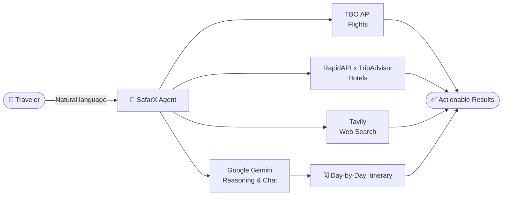
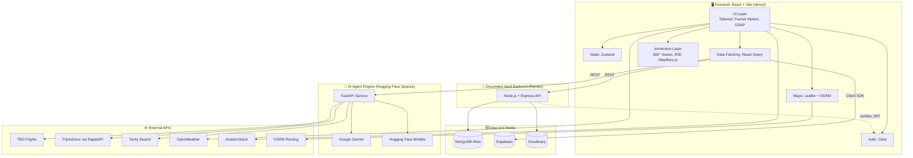

<div align="center">

# 🌍 PravasAI ✈️

### A Premium, AI-Powered Travel Discovery & Planning Platform for the Modern Explorer

*Discover · Preview · Plan · Book · Travel, all in one place*

[](https://safar360.vercel.app/)
[](#-hackathon-context)
[](#-hackathon-context)
[](#-license)


**[🚀 Live Demo](https://safar360.vercel.app/)** · **[🎥 Demo Video](#)** · **[📸 Screenshots](#-screenshots)** · **[🐛 Report Bug](https://github.com/lucky15426/Safar360/issues)** · **[💡 Request Feature](https://github.com/lucky15426/Safar360/issues)**

</div>

---

## 📑 Table of Contents

1. [About the Project](#-about-the-project)
2. [Problem Statement](#-problem-statement)
3. [Our Solution](#-our-solution)
4. [Key Features](#-key-features)
5. [SafarX AI Agent](#-safarx-ai-agent)
6. [Screenshots](#-screenshots)
7. [System Architecture](#-system-architecture)
8. [Tech Stack](#-tech-stack)
9. [Third-Party Integrations](#-third-party-integrations)
10. [Project Structure](#-project-structure)
11. [Installation & Setup](#-installation--setup)
12. [Environment Variables](#-environment-variables)
13. [Available Scripts](#-available-scripts)
14. [Deployment & Status](#-deployment--status)
15. [Security & Privacy](#-security--privacy)
16. [Challenges & Learnings](#-challenges--learnings)
17. [Roadmap](#-roadmap)
18. [Hackathon Context](#-hackathon-context)
19. [Team](#-team)
20. [Contributing](#-contributing)
21. [License](#-license)
22. [Acknowledgements](#-acknowledgements)

---

## 🧭 About the Project

**PravasAI** (*"Pravas"* means *journey* in Sanskrit/Hindi) is a premium, AI-powered travel discovery and planning platform designed for the modern explorer. Built for **VOYAGEHACK 3.0**, it redefines how people discover, plan, and experience travel by blending **immersive technology** (360° tours, VR, 3D terrain) with **intelligent planning tools** (an AI agent, smart itineraries, live flight and hotel search).

> 🔗 **Live:** [https://safar360.vercel.app/](https://safar360.vercel.app/)
> 📦 **Repository:** [github.com/lucky15426/Safar360](https://github.com/lucky15426/Safar360)

---

## ❗ Problem Statement

Travel planning today is slow, fragmented, and uncertain.

| Pain Point | Reality Today |
|---|---|
| 🧩 **Fragmented tools** | Travelers jump between search engines, blogs, booking sites, flight trackers, maps, and note apps to plan one trip. |
| ⏳ **Time-intensive research** | Hours go into comparing flights, hotels, routes, and activities. |
| 🤷 **Decision anxiety** | Travelers book destinations without truly knowing what they look and feel like. |
| 🗺️ **Generic recommendations** | Mainstream platforms push the same crowded landmarks and ignore local hidden gems. |
| 📄 **Document chaos** | Tickets, IDs, and confirmations are scattered across emails, screenshots, and chats. |
| 🧳 **Forgotten essentials** | There is no structured pre-trip preparation, so travelers often forget critical items. |

---

## 💡 Our Solution

PravasAI unifies the **entire travel lifecycle** in a single platform:

```
 Discover  ──►  Experience  ──►  Plan  ──►  Book  ──►  Prepare  ──►  Travel
   🌍             🥽 360°/VR      🗺️ AI      ✈️ TBO      🎒 Checklist   📁 Vault
 Hidden Gems     3D Terrain     Itinerary   Hotels                    ✈️ Live Tracker
```

Travelers can **try before they fly** through immersive previews, let the **SafarX AI agent** plan and book for them, keep all essentials in a **secure Document Vault**, and connect with others through **Social Groups**.

---

## 🚀 Key Features

### 🌐 Immersive Experiences

| Feature | Description |
|---|---|
| **360° Immersive Viewer** | Step into landmarks with high-fidelity panoramic tours of global wonders like the **Eiffel Tower**, **Taj Mahal**, and more. |
| **VR Views & 3D Exploration** | VR-compatible views and 3D terrain modeling for a realistic *"try-before-you-fly"* experience, powered by React Three Fiber. |
| **Interactive Maps** | Visual exploration of destinations with **real-time OSRM routing** and distance calculation, built on Leaflet. |
| **Global Music Experience** | Ambient sounds and music tailored to the destination being explored. |

### 🧠 Intelligent Planning

| Feature | Description |
|---|---|
| **Smart Itinerary Planner** | Generates personalized travel plans in seconds. The engine optimizes routes based on interests and travel style. |
| **Hidden Gems Discovery** | Uncovers secret local spots that are not on typical tourist maps, complete with stories and community-shared media. |
| **Trip Checklist** | Smart packing and pre-trip preparation tools so nothing essential is forgotten. |
| **SafarX AI Agent** | A premium AI travel co-pilot for chat, flights, hotels, web search, and itinerary generation. See [below](#-safarx-ai-agent). |

### 🛡️ Travel Utilities

| Feature | Description |
|---|---|
| **📁 Document Vault (Secure)** | An integrated wallet for travel essentials. Store tickets, IDs, and PDFs, backed by a dedicated Node.js/Express server hosted on Render. |
| **✈️ Live Flight Tracker** | Real-time oceanic and aerial tracking of flights worldwide, with a cinematic interface. |

### 🤝 Community

| Feature | Description |
|---|---|
| **Social Groups** | Join or create travel communities to plan group trips and share experiences. |

---

## 🤖 SafarX AI Agent

**SafarX** is the premium AI travel co-pilot at the heart of PravasAI. It combines a large language model with live travel data sources so answers are both **conversational** and **actionable**.

| Capability | Powered By | What It Does |
|---|---|---|
| 💬 **AI Chat** | Google Gemini | Natural-language travel queries and recommendations. |
| ✈️ **Flight Booking** | TBO API | Real-time flight search and booking. |
| 🏨 **Hotel Discovery** | RapidAPI × TripAdvisor | Live hotel listings and detailed property information. |
| 🔎 **Smart Web Search** | Tavily | Discovery of alternative stays, trains, and options beyond flights and hotels. |
| 🗓️ **Itinerary Generation** | Gemini + custom logic | Automated, personalized day-by-day travel plans. |



---

## 📸 Screenshots

> 🔧 **Add your screenshots to `docs/screenshots/`** and update the file names below.

| Landing Page | 360° Immersive Viewer |
|:---:|:---:|
|  |  |

| VR / 3D Terrain | Smart Itinerary Planner |
|:---:|:---:|
|  |  |

| SafarX AI Agent | Hidden Gems |
|:---:|:---:|
|  |  |

| Document Vault | Live Flight Tracker |
|:---:|:---:|
|  |  |

| Interactive Maps & Routing | Social Groups |
|:---:|:---:|
|  |  |

---

## 🏗️ System Architecture



### Architecture Highlights

- **Decoupled services:** The frontend, Document Vault backend, and AI engine are independent deployments, so each scales and fails separately.
- **Dedicated AI service:** The SafarX agent runs on its own FastAPI engine hosted on Hugging Face Spaces, keeping heavy AI workloads off the main API.
- **Hybrid data layer:** MongoDB powers the Document Vault, while Supabase supports application data. Cloudinary handles media and file storage.
- **Auth-first design:** Clerk secures the user experience on the client and verifies requests on the server.

---

## 🛠️ Tech Stack

### 🎨 Frontend

| Category | Technology |
|---|---|
| **Framework** | [React](https://react.dev/) + [Vite](https://vitejs.dev/) |
| **Styling** | [Tailwind CSS](https://tailwindcss.com/) |
| **Animations** | [Framer Motion](https://www.framer.com/motion/), [GSAP](https://greensock.com/gsap/) |
| **Maps & 3D** | [Leaflet](https://leafletjs.com/), [React Three Fiber](https://r3f.docs.pmnd.rs/), [Mapillary-js](https://www.mapillary.com/) |
| **State Management** | [Zustand](https://zustand-demo.pmnd.rs/) |
| **Data Fetching** | [React Query](https://tanstack.com/query/v3/) |
| **Authentication** | [Clerk](https://clerk.com/) |

### ⚙️ Backend & Services

| Category | Technology |
|---|---|
| **Runtime** | [Node.js](https://nodejs.org/) + [Express](https://expressjs.com/) (deployed on Render) |
| **Databases** | [Supabase](https://supabase.com/) & [MongoDB](https://www.mongodb.com/) |
| **AI Engines** | [Google Gemini Pro](https://deepmind.google/technologies/gemini/), [FastAPI](https://fastapi.tiangolo.com/), [Hugging Face](https://huggingface.co/) |
| **Media Storage** | [Cloudinary](https://cloudinary.com/) |

### ☁️ Hosting

| Service | Platform |
|---|---|
| Frontend | Vercel |
| Document Vault Backend | Render |
| AI Agent Engine | Hugging Face Spaces |

---

## 🔌 Third-Party Integrations

| Integration | Purpose |
|---|---|
| **TBO API** | Real-time flight search and booking |
| **TripAdvisor (via RapidAPI)** | Live hotel listings and details |
| **Tavily** | AI-optimized web search for alternative stays and trains |
| **Google Gemini** | Conversational AI and itinerary generation |
| **Hugging Face** | Hosting and additional AI models for the agent engine |
| **OSRM** | Real-time routing and distance calculation |
| **Mapillary** | Street-level imagery for immersive exploration |
| **OpenWeather** | Weather information for destinations |
| **AviationStack** | Flight data for the live tracker |
| **Cloudinary** | Media and document storage |
| **Clerk** | Authentication and user management |

---

## 📂 Project Structure

> 🔧 **Replace with your real tree.** Run `tree -I "node_modules|dist|.git"` in the project root and paste the output.

```
Safar360/
├── public/                    # Static assets
├── src/
│   ├── components/            # Reusable UI components
│   ├── pages/                 # Route-level pages
│   │   ├── Viewer360/         # 360° immersive viewer
│   │   ├── Planner/           # Smart itinerary planner
│   │   ├── HiddenGems/        # Hidden gems discovery
│   │   ├── SafarX/            # AI agent interface
│   │   ├── Vault/             # Document Vault UI
│   │   ├── FlightTracker/     # Live flight tracker
│   │   ├── Checklist/         # Trip checklist
│   │   └── Groups/            # Social groups
│   ├── store/                 # Zustand stores
│   ├── hooks/                 # Custom hooks & React Query hooks
│   ├── services/              # API clients
│   └── main.jsx               # App entry point
├── server/                    # Document Vault backend (Express)
│   ├── routes/
│   ├── controllers/
│   ├── models/
│   ├── middleware/
│   ├── .env
│   └── server.js
├── docs/
│   └── screenshots/
├── .env
├── package.json
├── vite.config.js
└── README.md
```

---

## 🏗️ Installation & Setup

### Prerequisites

Make sure you have the following ready:

- **Node.js** v20 or higher
- **npm** or **yarn**
- A **MongoDB Atlas** account
- A **Supabase** project
- A **Clerk** application
- A **Cloudinary** account
- A **Google Gemini** API key

### 1️⃣ Clone the Repository

```bash
git clone https://github.com/lucky15426/Safar360.git
cd Safar360
```

### 2️⃣ Install Frontend Dependencies

```bash
npm install
```

### 3️⃣ Configure Environment Variables

Create the frontend `.env` and the backend `server/.env` files as described in [Environment Variables](#-environment-variables).

### 4️⃣ Run the Document Vault Backend

```bash
cd server
npm install
npm run dev
```

The server starts on **http://localhost:5000**.

### 5️⃣ Run the AI Agent Engine (FastAPI)

> 🔧 **Update the folder name and commands to match your AI engine's repo/folder.**

```bash
cd ai-engine
python -m venv venv

# macOS / Linux
source venv/bin/activate
# Windows
venv\Scripts\activate

pip install -r requirements.txt
uvicorn main:app --reload --port 8000
```

The AI engine starts on **http://localhost:8000**.

### 6️⃣ Run the Frontend

From the project root:

```bash
npm run dev
```

Open the URL shown in your terminal (typically **http://localhost:5173**).

---

## 🔑 Environment Variables

### Frontend: `.env` (project root)

```env
VITE_CLERK_PUBLISHABLE_KEY=your_clerk_pub_key
VITE_GEMINI_API_KEY=your_gemini_key
VITE_API_BASE_URL=http://localhost:5000
VITE_AI_API_URL=http://localhost:8000
VITE_SUPABASE_URL=your_supabase_url
VITE_SUPABASE_ANON_KEY=your_supabase_anon_key
VITE_CLOUD_NAME=your_cloudinary_name
VITE_CLOUD_API_KEY=your_cloudinary_key
VITE_CLOUD_API_SECRET=your_cloudinary_secret
VITE_OPENWEATHER_API_KEY=your_openweather_key
VITE_AVIATION_STACK_API_KEY=your_aviation_stack_key
```

| Variable | Description |
|---|---|
| `VITE_CLERK_PUBLISHABLE_KEY` | Clerk publishable key for authentication |
| `VITE_GEMINI_API_KEY` | Google Gemini API key |
| `VITE_API_BASE_URL` | Base URL of the Document Vault backend |
| `VITE_AI_API_URL` | Base URL of the SafarX AI engine (FastAPI) |
| `VITE_SUPABASE_URL` | Supabase project URL |
| `VITE_SUPABASE_ANON_KEY` | Supabase anonymous (public) key |
| `VITE_CLOUD_NAME` | Cloudinary cloud name |
| `VITE_CLOUD_API_KEY` | Cloudinary API key |
| `VITE_CLOUD_API_SECRET` | Cloudinary API secret |
| `VITE_OPENWEATHER_API_KEY` | OpenWeather API key |
| `VITE_AVIATION_STACK_API_KEY` | AviationStack API key |

### Document Vault Backend: `server/.env`

```env
PORT=5000
MONGODB_URI=your_mongodb_uri
CLERK_SECRET_KEY=your_clerk_secret_key
CLOUDINARY_CLOUD_NAME=your_cloudinary_name
CLOUDINARY_API_KEY=your_cloudinary_key
CLOUDINARY_API_SECRET=your_cloudinary_secret
```

| Variable | Description |
|---|---|
| `PORT` | Port for the Express server |
| `MONGODB_URI` | MongoDB Atlas connection string |
| `CLERK_SECRET_KEY` | Clerk secret key for server-side verification |
| `CLOUDINARY_CLOUD_NAME` | Cloudinary cloud name |
| `CLOUDINARY_API_KEY` | Cloudinary API key |
| `CLOUDINARY_API_SECRET` | Cloudinary API secret |

### AI Engine: `.env`

> 🔧 **Add the keys your FastAPI engine reads** (names below are examples).

```env
GEMINI_API_KEY=your_gemini_key
TBO_USERNAME=your_tbo_username
TBO_PASSWORD=your_tbo_password
RAPIDAPI_KEY=your_rapidapi_key
TAVILY_API_KEY=your_tavily_key
HUGGINGFACE_TOKEN=your_hf_token
```

> ⚠️ **Never commit `.env` files.** Make sure `.env` is listed in `.gitignore`.

---

## 📜 Available Scripts

| Command | Location | Description |
|---|---|---|
| `npm run dev` | root | Start the Vite development server |
| `npm run build` | root | Create an optimized production build |
| `npm run preview` | root | Preview the production build locally |
| `npm run dev` | `server/` | Start the Document Vault backend |
| `uvicorn main:app --reload --port 8000` | AI engine | Start the SafarX FastAPI engine |

> 🔧 Adjust to match your actual `package.json` scripts.

---

## 🚢 Deployment & Status

| Component | Platform | Status |
|---|---|---|
| 🖥️ **Frontend** | Vercel | ✅ Live: [safar360.vercel.app](https://safar360.vercel.app/) |
| 📁 **Backend (Document Vault)** | Render | ✅ Deployed |
| 🤖 **AI Agent Engine** | Hugging Face Spaces | ✅ Deployed |

### Deploying Your Own Instance

1. **Frontend (Vercel):** Import the repository, set the framework preset to **Vite**, add all `VITE_*` variables, and deploy.
2. **Backend (Render):** Create a new **Web Service** from the `server/` directory, set the start command to `node server.js` (or your start script), and add the backend environment variables.
3. **AI Engine (Hugging Face Spaces):** Create a new Space for the FastAPI app, add your secrets under **Settings → Variables and secrets**, and update `VITE_AI_API_URL` to the Space URL.

> 🔧 Add your live Render and Hugging Face URLs here if you want to share them publicly.

---

## 🔒 Security & Privacy

The **Document Vault** handles sensitive travel documents, so security is a core concern:

- 🔐 **Authenticated access:** Clerk authentication gates the vault, and the backend verifies requests using the Clerk secret key.
- 🧱 **Dedicated backend:** Document handling runs on its own Express server, separate from the frontend.
- ☁️ **Managed storage:** Files are stored with Cloudinary, and metadata is stored in MongoDB Atlas.
- 🔑 **Secrets management:** Credentials live in environment variables and are never committed to source control.
- 🌐 **HTTPS everywhere:** All deployments (Vercel, Render, Hugging Face) are served over HTTPS.

---

## 🧠 Challenges & Learnings

| Challenge | How We Approached It |
|---|---|
| Delivering **immersive 360° and VR experiences** in the browser | Combined React Three Fiber and panoramic viewers so previews work directly from a web link |
| Orchestrating **multiple live APIs** (flights, hotels, search) behind one agent | Built the SafarX agent to route each query to the right data source and merge results |
| Running **AI workloads without slowing the main app** | Isolated the agent engine as a separate FastAPI service on Hugging Face Spaces |
| Keeping a **heavily animated UI performant** | Used Framer Motion and GSAP selectively, with React Query caching to avoid redundant requests |
| Managing **sensitive documents** responsibly | Built an authenticated, dedicated vault backend with managed file storage |
| Shipping a **full-stack product under hackathon time limits** | Split the system into independent services so work could happen in parallel |

---

## 🗺️ Roadmap

- [x] 360° immersive viewer
- [x] VR views & 3D terrain exploration
- [x] Smart itinerary planner
- [x] Hidden gems discovery
- [x] Secure Document Vault
- [x] Live flight tracker
- [x] Trip checklist
- [x] SafarX AI agent (chat, flights, hotels, web search, itinerary)
- [x] Interactive maps with OSRM routing
- [x] Social groups
- [ ] 💳 In-app payments and booking confirmation flow
- [ ] 🌐 Multi-language support
- [ ] 📴 Offline mode (PWA) for travel days
- [ ] 💱 Currency converter and budget tracker
- [ ] 🧑‍🤝‍🧑 Real-time collaborative itinerary editing for groups
- [ ] 📱 Native mobile apps (iOS & Android)
- [ ] 🧭 More 360° destinations and community-contributed tours

---

## 🏆 Hackathon Context

PravasAI was built for **VOYAGEHACK 3.0**, a travel-tech hackathon centered on solving real-world travel challenges, and is being submitted to **DevForge, Yugaantar 2026**.

**What sets PravasAI apart**

- ✅ **End-to-end journey coverage:** from inspiration to immersive preview, planning, booking, and travel day
- ✅ **Real, live integrations:** TBO flights, TripAdvisor hotels, Tavily search, and OSRM routing
- ✅ **AI that acts, not just chats:** SafarX searches and books instead of only suggesting
- ✅ **Try-before-you-fly:** 360° tours, VR views, and 3D terrain
- ✅ **Production-style architecture:** three independently deployed services

---

## 👥 Team

> 🔧 **Fill in your details.**

| Name | Role | GitHub | LinkedIn |
|---|---|---|---|
| **Your Name** | Full-Stack Developer | [@lucky15426](https://github.com/lucky15426) | [Profile](https://linkedin.com/in/your-id) |
| *Teammate* | *Role* | [@username](https://github.com/username) | [Profile](https://linkedin.com/in/username) |

---

## 🤝 Contributing

Contributions, issues, and feature requests are welcome!

1. **Fork** the repository
2. **Create** your feature branch: `git checkout -b feature/amazing-feature`
3. **Commit** your changes: `git commit -m "feat: add amazing feature"`
4. **Push** to the branch: `git push origin feature/amazing-feature`
5. **Open** a Pull Request

---

## 📄 License

Distributed under the **MIT License**. See [`LICENSE`](LICENSE) for more information.

> 🔧 Add a `LICENSE` file to the repo, or change this section if you use a different license.

---

## 🙏 Acknowledgements

- **TBO.com** and the **VOYAGEHACK** team for the opportunity and the real-world problem statements
- **DevForge, Yugaantar 2026** organizers
- [Google Gemini](https://deepmind.google/technologies/gemini/), [Hugging Face](https://huggingface.co/), [Tavily](https://tavily.com/), and [RapidAPI](https://rapidapi.com/) for powering the AI and data layers
- [Clerk](https://clerk.com/), [Supabase](https://supabase.com/), [MongoDB Atlas](https://www.mongodb.com/atlas), and [Cloudinary](https://cloudinary.com/) for infrastructure
- [Vercel](https://vercel.com/) and [Render](https://render.com/) for hosting
- [OpenStreetMap](https://www.openstreetmap.org/), [OSRM](https://project-osrm.org/), [Leaflet](https://leafletjs.com/), and [Mapillary](https://www.mapillary.com/) for mapping and street-level imagery
- The open-source community behind React, Vite, Tailwind, Three.js, and every library used here

---

<div align="center">

### ⭐ If you like PravasAI, please star the repository!

**Made with ❤️ for explorers everywhere**

*Pravas karo, PravasAI ke saath.* 🌏✈️

</div>
