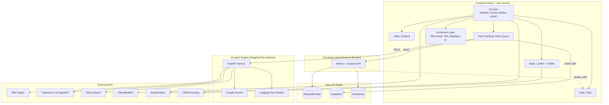
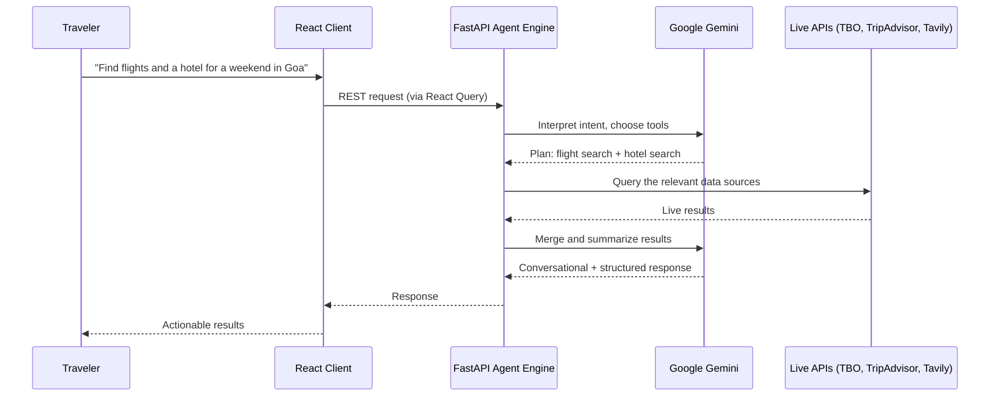

# PravasAI

**An AI-powered travel discovery and planning platform.**
Discover · Preview · Plan · Book · Travel, all in one place.


---

## Table of Contents

- [Overview](#overview)
- [System Architecture](#system-architecture)
- [Tech Stack](#tech-stack)
- [Key Features](#key-features)
  [Third-Party Integrations](#third-party-integrations)
- [Project Structure](#project-structure)
- [Getting Started](#getting-started)
- [Environment Variables](#environment-variables)
- [Available Scripts](#available-scripts)
- [Deployment](#deployment)
- [Security and Privacy](#security-and-privacy)
- [Challenges and Learnings](#challenges-and-learnings)
- [Roadmap](#roadmap)
- [Author](#author)
- [Contributing](#contributing)
- [License](#license)
- [Acknowledgements](#acknowledgements)

---

## Overview

**PravasAI** ("Pravas" means *journey* in Sanskrit and Hindi) brings the whole travel lifecycle into one platform. Travel planning today is fragmented: people jump between search engines, blogs, booking sites, flight trackers, maps, and note apps, and often book places without knowing what they really look like.

PravasAI addresses this by combining:

- **Immersive previews:** 360° tours, VR views, and 3D terrain, so travelers can try before they fly.
- **Intelligent planning:** an AI agent , smart itineraries, hidden-gem discovery, and a trip checklist.
- **Live travel data:** real-time flight and hotel search, routing, weather, and flight tracking.
- **Travel utilities:** a secure document vault and social groups for group trips.

```
Discover → Experience → Plan → Book → Prepare → Travel
```

---

## System Architecture

PravasAI is built as **three independently deployed services** (frontend, document vault backend, AI agent engine) on top of a shared data and media layer and a set of external APIs.



### Layers at a glance

| Layer | Responsibility | Key technologies |
|---|---|---|
| **Client** | UI, routing, state, auth, immersive 360°/VR/3D views, maps | React, Vite, Tailwind, Zustand, React Query, Clerk, React Three Fiber, Leaflet |
| **Document Vault API** | Authenticated upload, storage, and retrieval of travel documents | Node.js, Express, MongoDB Atlas, Cloudinary |
| **AI Agent Engine** | Reasoning, tool routing, itinerary generation, live flight/hotel/web lookups | FastAPI, Google Gemini, Hugging Face |
| **Data and Media** | Document metadata, application data, media and file storage | MongoDB Atlas, Supabase, Cloudinary |
| **External APIs** | Live travel, weather, flight, and routing data | TBO, TripAdvisor (RapidAPI), Tavily, OpenWeather, AviationStack, OSRM |

### Typical SafarX request flow



### Design decisions

| Decision | Why |
|---|---|
| **Decoupled services** | Frontend, vault, and AI engine deploy, scale, and fail independently. |
| **Dedicated AI service** | Heavy AI workloads stay off the main API, so the app remains responsive. |
| **Hybrid data layer** | MongoDB fits document metadata, Supabase handles application data, Cloudinary handles binary files. |
| **Auth-first security** | Clerk secures the client, and the vault backend verifies every request server-side. |
| **Client-side data caching** | React Query avoids redundant requests in a heavily animated, data-rich UI. |

---

## Tech Stack

### Frontend

| Category | Technology | Role |
|---|---|---|
| Framework | React + Vite | Component-based UI with fast builds and HMR |
| Styling | Tailwind CSS | Utility-first styling |
| Animation | Framer Motion, GSAP | UI transitions and cinematic effects |
| 3D / VR | React Three Fiber | 3D terrain and VR-compatible views |
| Street-level imagery | Mapillary-js | Immersive street views |
| Maps | Leaflet + OSRM | Interactive maps, routing, and distance calculation |
| State management | Zustand | Lightweight global state |
| Data fetching | React Query | Caching and request management |
| Authentication | Clerk | User management and sessions |

### Backend and AI

| Category | Technology | Role |
|---|---|---|
| Vault API | Node.js + Express | Secure document handling |
| AI engine | FastAPI | Agent orchestration service |
| LLM | Google Gemini | Chat, reasoning, itinerary generation |
| Model hosting | Hugging Face | Additional models for the agent engine |

### Data and Storage

| Category | Technology | Role |
|---|---|---|
| Document database | MongoDB Atlas | Vault metadata |
| Application database | Supabase | Application data |
| Media storage | Cloudinary | Files, images, and documents |

### Hosting

| Service | Platform |
|---|---|
| Frontend | Vercel |
| Document Vault backend | Render |
| AI agent engine | Hugging Face Spaces |

---

## Key Features

### Immersive Experiences

| Feature | Description |
|---|---|
| 360° Immersive Viewer | High-fidelity panoramic tours of global landmarks. |
| VR Views and 3D Terrain | VR-compatible views and 3D terrain modeling built with React Three Fiber. |
| Interactive Maps | Destination exploration with OSRM routing and distance calculation. |
| Global Music Experience | Ambient sounds and music matched to the destination. |

### Intelligent Planning

| Feature | Description |
|---|---|
| Smart Itinerary Planner | Personalized plans that optimize routes by interests and travel style. |
| Hidden Gems Discovery | Local spots missing from typical tourist maps, with stories and community media. |
| Trip Checklist | Packing and pre-trip preparation so nothing essential is forgotten. |


### Travel Utilities and Community

| Feature | Description |
|---|---|
| Document Vault | Secure wallet for tickets, IDs, and PDFs. |
| Live Flight Tracker | Real-time tracking of flights worldwide. |
| Social Groups | Join or create travel communities to plan group trips. |

---

## Third-Party Integrations

| Integration | Purpose |
|---|---|
| TBO API | Real-time flight search and booking |
| TripAdvisor (via RapidAPI) | Live hotel listings and details |
| Tavily | AI-optimized web search for alternative stays and trains |
| Google Gemini | Conversational AI and itinerary generation |
| Hugging Face | Hosting and additional models for the AI engine |
| OSRM | Real-time routing and distance calculation |
| Mapillary | Street-level imagery |
| OpenWeather | Destination weather information |
| AviationStack | Flight data for the live tracker |
| Cloudinary | Media and document storage |
| Clerk | Authentication and user management |

---

## Project Structure

```
PravasAI/
├── public/                    # Static assets
├── src/
│   ├── components/            # Reusable UI components
│   ├── pages/                 # Route-level pages
│   │   ├── Viewer360/         # 360° immersive viewer
│   │   ├── Planner/           # Smart itinerary planner
│   │   ├── HiddenGems/        # Hidden gems discovery
│   │   ├── Vault/             # Document Vault UI
│   │   ├── FlightTracker/     # Live flight tracker
│   │   ├── Checklist/         # Trip checklist
│   │   └── Groups/            # Social groups
│   ├── store/                 # Zustand stores
│   ├── hooks/                 # Custom and React Query hooks
│   ├── services/              # API clients
│   └── main.jsx               # App entry point
├── server/                    # Document Vault backend (Express)
│   ├── routes/
│   ├── controllers/
│   ├── models/
│   ├── middleware/
│   └── server.js
├── .env
├── package.json
├── vite.config.js
└── README.md
```

---

## Getting Started

### Prerequisites

- Node.js v20 or higher
- npm or yarn
- Python 3.10+ (for the AI engine)
- A MongoDB Atlas account
- A Supabase project
- A Clerk application
- A Cloudinary account
- A Google Gemini API key

### 1. Clone the repository

```bash
git clone https://github.com/sweetylearner-max/PravasAI-.git
cd PravasAI-
```

### 2. Install frontend dependencies

```bash
npm install
```

### 3. Configure environment variables

Create the frontend `.env` and the backend `server/.env` as described in [Environment Variables](#environment-variables).

### 4. Run the Document Vault backend

```bash
cd server
npm install
npm run dev
```

The server starts on `http://localhost:5000`.

### 5. Run the AI engine (FastAPI)

```bash
cd ai-engine
python -m venv venv

# macOS / Linux
source venv/bin/activate
# Windows
venv\Scripts\activate

pip install -r requirements.txt
uvicorn main:app --reload --port 8000
```

The AI engine starts on `http://localhost:8000`.

### 6. Run the frontend

From the project root:

```bash
npm run dev
```

Open the URL shown in your terminal (typically `http://localhost:5173`).

---

## Environment Variables

### Frontend: `.env` (project root)

```env
VITE_CLERK_PUBLISHABLE_KEY=your_clerk_pub_key
VITE_GEMINI_API_KEY=your_gemini_key
VITE_API_BASE_URL=http://localhost:5000
VITE_AI_API_URL=http://localhost:8000
VITE_SUPABASE_URL=your_supabase_url
VITE_SUPABASE_ANON_KEY=your_supabase_anon_key
VITE_CLOUD_NAME=your_cloudinary_name
VITE_CLOUD_API_KEY=your_cloudinary_key
VITE_CLOUD_API_SECRET=your_cloudinary_secret
VITE_OPENWEATHER_API_KEY=your_openweather_key
VITE_AVIATION_STACK_API_KEY=your_aviation_stack_key
```

| Variable | Description |
|---|---|
| `VITE_CLERK_PUBLISHABLE_KEY` | Clerk publishable key |
| `VITE_GEMINI_API_KEY` | Google Gemini API key |
| `VITE_API_BASE_URL` | Base URL of the Document Vault backend |
| `VITE_AI_API_URL` | Base URL of the SafarX AI engine |
| `VITE_SUPABASE_URL` | Supabase project URL |
| `VITE_SUPABASE_ANON_KEY` | Supabase anonymous (public) key |
| `VITE_CLOUD_NAME` | Cloudinary cloud name |
| `VITE_CLOUD_API_KEY` | Cloudinary API key |
| `VITE_CLOUD_API_SECRET` | Cloudinary API secret |
| `VITE_OPENWEATHER_API_KEY` | OpenWeather API key |
| `VITE_AVIATION_STACK_API_KEY` | AviationStack API key |

### Document Vault backend: `server/.env`

```env
PORT=5000
MONGODB_URI=your_mongodb_uri
CLERK_SECRET_KEY=your_clerk_secret_key
CLOUDINARY_CLOUD_NAME=your_cloudinary_name
CLOUDINARY_API_KEY=your_cloudinary_key
CLOUDINARY_API_SECRET=your_cloudinary_secret
```

### AI engine: `ai-engine/.env`

```env
GEMINI_API_KEY=your_gemini_key
TBO_USERNAME=your_tbo_username
TBO_PASSWORD=your_tbo_password
RAPIDAPI_KEY=your_rapidapi_key
TAVILY_API_KEY=your_tavily_key
HUGGINGFACE_TOKEN=your_hf_token
```

> **Note:** Never commit `.env` files. Make sure `.env` is listed in `.gitignore`.

---

## Available Scripts

| Command | Location | Description |
|---|---|---|
| `npm run dev` | root | Start the Vite development server |
| `npm run build` | root | Create an optimized production build |
| `npm run preview` | root | Preview the production build locally |
| `npm run dev` | `server/` | Start the Document Vault backend |
| `uvicorn main:app --reload --port 8000` | `ai-engine/` | Start the SafarX FastAPI engine |

---

## Deployment

| Component | Platform |
|---|---|
| Frontend | Vercel |
| Document Vault Backend | Render |
| AI Agent Engine | Hugging Face Spaces |

1. **Frontend (Vercel):** Import the repository, set the framework preset to Vite, add all `VITE_*` variables, and deploy.
2. **Backend (Render):** Create a new Web Service from the `server/` directory, set the start command to `node server.js`, and add the backend environment variables.
3. **AI Engine (Hugging Face Spaces):** Create a new Space for the FastAPI app, add your secrets under *Settings → Variables and secrets*, and set `VITE_AI_API_URL` to the Space URL.

---

## Security and Privacy

- **Authenticated access:** Clerk gates the vault, and the backend verifies requests using the Clerk secret key.
- **Dedicated backend:** Document handling runs on its own Express server, separate from the frontend.
- **Managed storage:** Files are stored in Cloudinary and metadata in MongoDB Atlas.
- **Secrets management:** Credentials live in environment variables and are never committed to source control.
- **HTTPS everywhere:** All deployments are served over HTTPS.

---

## Challenges and Learnings

| Challenge | Approach |
|---|---|
| Delivering immersive 360° and VR experiences in the browser | Combined React Three Fiber and panoramic viewers so previews work directly in the browser. |
| Orchestrating multiple live APIs behind one agent | Built SafarX to route each query to the right data source and merge the results. |
| Running AI workloads without slowing the main app | Isolated the agent as a separate FastAPI service. |
| Keeping a heavily animated UI performant | Used Framer Motion and GSAP selectively, with React Query caching to avoid redundant requests. |
| Managing sensitive documents responsibly | Built an authenticated, dedicated vault backend with managed file storage. |
| Shipping a full-stack product end to end | Split the system into independent services so each part could be built, deployed, and scaled separately. |

---

## Roadmap

- [x] 360° immersive viewer
- [x] VR views and 3D terrain exploration
- [x] Smart itinerary planner
- [x] Hidden gems discovery
- [x] Secure Document Vault
- [x] Live flight tracker
- [x] Trip checklist
- [x] SafarX AI agent (chat, flights, hotels, web search, itinerary)
- [x] Interactive maps with OSRM routing
- [x] Social groups
- [ ] In-app payments and booking confirmation flow
- [ ] Multi-language support
- [ ] Offline mode (PWA) for travel days
- [ ] Currency converter and budget tracker
- [ ] Real-time collaborative itinerary editing
- [ ] Native mobile apps (iOS and Android)
- [ ] More 360° destinations and community-contributed tours

---

## Author

Designed and developed by [@sweetylearner-max](https://github.com/sweetylearner-max).

---

## Contributing

Contributions, issues, and feature requests are welcome.

1. Fork the repository
2. Create your feature branch: `git checkout -b feature/amazing-feature`
3. Commit your changes: `git commit -m "feat: add amazing feature"`
4. Push to the branch: `git push origin feature/amazing-feature`
5. Open a Pull Request

---

## License

Distributed under the MIT License. See [LICENSE](LICENSE) for more information.

---

## Acknowledgements

- TBO for the flight search and booking APIs
- Google Gemini, Hugging Face, Tavily, and RapidAPI for the AI and data layers
- Clerk, Supabase, MongoDB Atlas, and Cloudinary for infrastructure
- Vercel and Render for hosting
- OpenStreetMap, OSRM, Leaflet, and Mapillary for mapping and street-level imagery
- The open-source community behind React, Vite, Tailwind, Three.js, and every library used here

---

*Pravas karo, PravasAI ke saath.*
